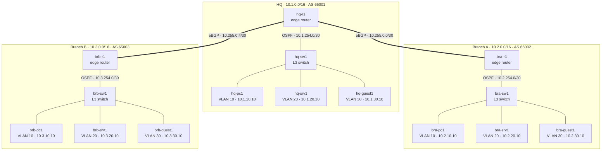

# Phase 1 Topology

Ports: edge routers use `eth1` for the LAN; HQ uses `eth2` (Branch A) and `eth3` (Branch B) for the WAN, branches use `eth2`. Switches use `eth1` uplink, `eth2` = VLAN 10, `eth3` = VLAN 20, `eth4` = VLAN 30. VLAN 99 has a gateway on each switch but no ports yet.
